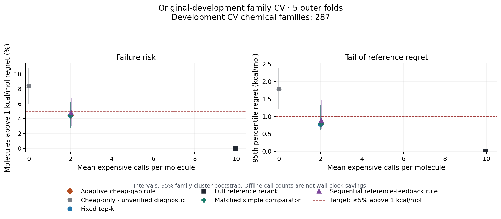

# Adaptive Quantum Chemistry · v0.3 MVP

**Open the local conformer workbench:** extract the complete repository, then
run the following command from its folder with Python 3.10 or newer:

```bash
python -m aqc_app
```

The application opens in your browser. **No pip installation, scientific
packages, Node, API account, or quantum software is needed to use the app.**
Python itself must already be installed. On Windows, double-click
`start-aqc.cmd`; on Linux or macOS, run `sh start-aqc.sh`. Keep the terminal
open while using the workbench. It listens only on this computer at
`http://127.0.0.1:8765/`.

Choose a real development molecule, rotate its verified 3D coordinates,
select a policy, and reveal reference energies one charged query at a time.
The Python server retains unqueried references. Finish a decision to see its
regret, save or export the queried trace, and compare the recorded operating
points in **Measured results**. Imported traces are labeled unverified,
read-only user snapshots; they never become benchmark evidence.

If startup fails, run `python scripts/doctor.py`. For an occupied port, use
`python -m aqc_app --port 8766`. Add `--no-open` to print the local address
without opening a browser. See the [acceptance record](docs/MVP_ACCEPTANCE.md)
and [HTTP API contract](aqc_app/API.md) for tested behavior and limits.

<details>
<summary>Development preview and responsive QA</summary>

To run the local app without opening a browser, use:

```bash
python scripts/preview.py --port 4173
```

For the optional browser layout harness, add `--responsive-check` and open
`http://127.0.0.1:4173/__qa__/responsive`. It displays the real app in a
same-origin frame at selectable CSS widths. The `/__qa__/responsive` and
`/__qa__/app` routes exist only in this development mode; the normal
`python -m aqc_app` runtime does not enable them. The preview still binds only
to loopback. A narrow iframe is a layout check, not physical mobile acceptance
or a hosted deployment. See the [acceptance record](docs/MVP_ACCEPTANCE.md) for
executed checks and remaining gates.

</details>

The app has a responsive interface; it is **not a hosted service or a native
phone app**. A phone cannot reach a different computer through that computer's
loopback address. Native Windows/macOS and physical phone acceptance remain
separate from the executed Linux/API/browser checks.

The historical [v0.2 portable lab](results/lab/dashboard.html) remains available
as an inspectable client-side demonstration. The new local application uses a
server-enforced reference boundary. Both display the same frozen scientific
measurements; v0.3 adds product functionality, not a new scientific result.

This repository implements a reproducible CLI benchmark for deciding which
conformers deserve expensive reference single points. Version 0.2 registers
**1,020 parameter configurations: 204 original configurations plus 816 new
reference-feedback rules**, applied to **478 original development molecules
in 287 chemical families**, with **five family-blocked validation folds**.
That is **487,560 configuration–molecule replays**, not 487,560 independent
scientific replications. Different configurations can produce identical
behavior; the output reports that separately.

The original 162-molecule, 124-family evaluation remains **historical v0.1
evidence**. Version 0.2 does not reuse those labels to select new policies and
does not claim a fresh external holdout. See the
[registered protocol](docs/EXPERIMENT_PROTOCOL_V02.md),
[data provenance](docs/PROVENANCE.md), and
[independent prefreeze review](verification/v02/independent-review.md).

<!-- V02_EXECUTED_RESULT_START -->
## Executed v0.2 result: the new feedback rule did not earn its extra calls

**Sequential reference feedback succeeded on 455/478 molecules (95.19%) using
973 calls. The frozen matched simple comparator succeeded on 457/478 (95.61%)
using 964 calls.** The sequential policy used nine more calls and had two
additional failures. Its observed call saving was **−0.934%**, so the target
of at least 95% success with at least 30% fewer calls at matched risk was
**not met**.

These are out-of-fold results on the **287 original development families**,
each validated once across five folds. The validation folds contained
58, 58, 57, 57, and 57 families, respectively, and 96, 92, 88, 96, and 106
molecules. This is internal development validation; **no fresh external
holdout was used**.

| Out-of-fold policy role | Success ≤1 kcal/mol | Median regret | P95 regret | Worst regret | Mean calls | Total calls | Fallback |
|---|---:|---:|---:|---:|---:|---:|---:|
| Full reference rerank | 100.00% (478/478) | 0.000 | 0.000 | 0.000 | 9.960 | 4,761 | 0% |
| Fixed top-2 | 95.61% (457/478) | 0.000 | 0.778 | 5.147 | 2.000 | 956 | 0% |
| Adaptive cheap-window | 95.61% (457/478) | 0.000 | 0.778 | 5.147 | 2.017 | 964 | 0.21% |
| Frozen matched simple comparator | 95.61% (457/478) | 0.000 | 0.778 | 5.147 | 2.017 | 964 | 0.21% |
| Sequential reference-feedback | 95.19% (455/478) | 0.000 | 0.898 | 5.147 | 2.036 | 973 | 0% |
| Cheap-only, unverified diagnostic | 91.63% (438/478) | 0.054 | 1.793 | 5.228 | 0.000 | 0 | 0% |

Regrets are kcal/mol relative to the best reference in the same candidate
pool. Operating points were selected separately on the other four folds.
The fixed rule selected k=2 in every fold. Its lower observed cost is useful
context; the primary comparison retains the matched simple comparator chosen
by the registered training-only rule.

With seed **271828** and **5,000** paired family-bootstrap draws, sequential
versus matched simple call savings were **−0.934% [−5.824%, +3.444%]**. The
success difference was **−0.418 percentage points [−1.237, +0.426]**. These
descriptive 95% intervals condition on the chosen folds and policies and
include no difference; they do not establish that sequential feedback is
intrinsically worse. Sequential success had interval **93.20%–97.01%**, so
the point estimate also does not certify a ≥95% population guarantee.



All **487,560** registered configuration–molecule replays completed and were
audited, accounting for **1,803,309 offline charged-job equivalents**. The
1,020 parameter configurations produced **659 distinct acquisition/selection
behaviors** across the development pools. Trace storage contains **5,239
distinct query histories**; deduplication did not waive any calls.
An additional **2,390 selected configuration–molecule replays**, accounting
for **7,654 additional charged-job equivalents**, independently reproduced
their recorded outcomes. The complete evidence seal passed verification.
These counts describe offline replay, not actual quantum jobs or compute
expenditure.

See the [executed report](results/lab/REPORT.md),
[decision record](results/lab/decision.json),
[per-molecule table](results/lab/per_molecule.csv), and
[paired comparisons](results/lab/paired_comparisons.csv). The new measurement
system has not demonstrated a shape probe's value. Any next shape-aware
experiment must earn an improvement over these simple paid baselines; the
larger heuristic search alone did not do so.
<!-- V02_EXECUTED_RESULT_END -->

## Install

Use Python **3.12**; the recorded runtime is **3.12.14**. All numerical,
chemistry, plotting, and transitive dependencies are pinned in
[`requirements.txt`](requirements.txt).

```bash
python3 -m venv .venv
source .venv/bin/activate
python -m pip install -r requirements.txt
python -m pip check
```

The executed environment is Linux. Native Windows execution is not claimed.
For PowerShell, the corresponding environment commands are
`py -3.12 -m venv .venv` and `.venv\Scripts\Activate.ps1`; the remaining
commands use `python`. Node.js is needed to execute the JavaScript/Python
policy-parity tests. Those tests explicitly skip if Node is unavailable;
the Python CLI does not need Node.

## Run and verify

Run commands from the repository root. Use a new output directory for a new
run: registered, frozen, and sealed runs refuse silent overwriting.

**After a Git clone**, restore the large saved decision ledger from its
checksummed transport chunks before verifying or rebuilding the delivered
experiment:

```bash
python scripts/archive_evidence.py restore
```

This reconstructs the exact original gzip bytes without recompressing or
changing the evidence seal. The complete downloadable archive already
contains the restored ledger and does not need this step.

### One command for the synthetic fixture

```bash
python -m aqc fixture --out runs/fixture-v02 --bootstrap 5000
```

This exercises the baseline preparation, development selection, frozen
reference evaluation, accounting, and dashboard pipeline on explicitly
synthetic labels. Its cases include useful escalation, wasted escalation,
and confidently wrong cheap rankings. Synthetic outcomes are never presented
as molecular performance.

### One command for the real baseline replay

```bash
python -m aqc real --out runs/real-v02 --bootstrap 5000
```

The distribution includes a checksummed compressed snapshot of the required
upstream files. After dependency installation, this command needs **no data
download**. It verifies the snapshot, reconstructs geometry and energy
pairing, prepares the original family split, tunes the original simple rules,
freezes their choices, and evaluates them in a separate process.

This command retains the original fixed/window/full benchmark and split;
it is not a fresh validation cohort. The expanded sequential-policy experiment
is the separate `experiments` command below. If the bundled snapshot is absent,
the CLI clones the public source and checks out the pinned revision. A clean
checkout can also be supplied explicitly:

```bash
python -m aqc real --source /path/to/conformer-benchmark --out runs/real-checkout
```

### Reproduce the historical sealed evaluation without retuning

```bash
python -m aqc reproduce --run results/real --out runs/reproduced-v01
```

For this historical v0.1 run, the CLI verifies the retained source in
`releases/v0.1.0`, matches its module hashes to the original frozen record,
and dispatches reproduction to that engine. It compares the original five
sealed scientific outputs byte for byte. The original source-hash guard is
preserved; v0.2 code is not substituted into the historical experiment.

The retained release manifest also records the checksums of **58 historical
result artifacts** across `results/real` and `results/fixture`. Those records
remain unchanged. The historical engine retains its documented v0.1 failure
and integrity limitations and is used for reproduction, not new development.

### Run the 1,020-configuration development experiment

```bash
python -m aqc experiments --prepared results/real/prepared --out runs/lab --historical results/real --seed 271828 --bootstrap 5000
```

This freezes the registry, source/data hashes, fold assignments, and selection
rule before executing the grid. It uses only the **original development
cohort**, writes every configuration–pool decision, selects operating points
using four folds, and scores each selected rule on the remaining fold. It
then audits the ledger, independently replays selected decisions, seals the
outputs, and builds the interactive lab.

The delivered run uses `results/lab`. Independently verify its complete
ledger and rerun its selected policies with:

```bash
python -m aqc verify-experiments --results results/lab --prepared results/real/prepared --replay-selected
```

The selected-policy verification replays are additional executions with their
own query accounting; they are not included in the 487,560 grid decisions.
To rebuild the lab from verified saved evidence:

```bash
python -m aqc lab --results results/lab --historical results/real --prepared results/real/prepared
```

Open the resulting file in an actual browser. If local HTML opening is
restricted, serve the repository locally and visit
<http://127.0.0.1:8765/results/lab/dashboard.html>:

```bash
python -m http.server 8765 --bind 127.0.0.1
```

The bundled 3D display asset can be independently verified and rebuilt from
the pinned source snapshot without reading a reference-energy table:

```bash
python scripts/build_viewer_geometry.py
```

To check the artifact seal or run the test suite:

```bash
python -m aqc verify --run results/lab --complete
python -m unittest discover -s tests -v
```

`reproduce` serves frozen baseline runs. `verify-experiments` serves the
registered development experiment; it does not retune or replace its saved
choices.

## What the interactive lab shows

The lab opens to the **Query simulator and 3D molecular view**. Select a
development molecule and step through a policy or play its queries slowly;
the explorer and evidence views are available from the navigation.

The explorer separates **pooled development results**, **out-of-fold family
cross-validation**, and **immutable historical evaluation**. Filters and
plots inspect saved results; changing a filter does not promote an operating
point into validated evidence.

The query simulator supports stepping, slow playback, full policy execution,
and manual paid queries. It shows the cheap ranking, charged query order,
reference observations, the current best verified candidate, stopping reason,
and final regret. Each comparison starts with an empty cache. Reference
energy differences are displayed relative to the first successful paid
observation, never an unqueried reference minimum.

The simulator contains **development molecules only**. Its downloaded HTML
necessarily contains evaluator labels, which a technically knowledgeable user
can inspect. It is an educational replay with a charged-query interface,
not a secure browser sandbox for hostile users. The isolated CLI worker is
the actual experiment boundary. Local simulator trials are exploratory and
do not alter the registered results.

Failure anatomy compares the first and second reference query on development
molecules, distinguishing threshold rescues from calls that do not change
success. Evidence and integrity panels distinguish a computed file hash from
one checked against a saved seal. No shape descriptors or new quantum results
are generated by the interface.

### Real molecular geometries in JavaScript

The JavaScript renderer uses WebGL. If WebGL is unavailable, the interface
explicitly labels its projected-3D canvas fallback.

The 3D view uses the published optimized XYZ coordinates for all **478
development molecules and 4,761 conformers**, containing **186,905 atom
records**. Its compressed 2.21 MB coordinate asset is included at
`data/development_geometry.json.gz`. The builder checks each source file's
bytes against the pinned upstream lock and checks its ordered atom/coordinate
identity against the original geometry audit. The companion
`data/development_geometry_manifest.json` records the asset, source, split,
and geometry-manifest hashes.

Drag to rotate, Shift-drag to pan, and scroll or pinch to zoom; keyboard arrows
rotate the focused view. Choose a conformer, change between ball-and-stick,
wireframe, and space-filling views, show or hide hydrogens, turn on slow
rotation, or reset the camera. “Follow acquisition” connects the geometry to
the current query; the simulator also supports slow query playback. Looking
at a conformer does not reveal its reference energy. A manual reveal is a
charged query, and any displayed reference difference uses only a successful
paid observation.

Distance-inferred bonds are **display guides, not verified chemical bond
orders**. Coordinates, inferred bonds, and rendering choices never enter the
policy's feature payload, grid tuning, or recorded scientific outcomes. This
viewer adds an inspectable representation of the existing candidate pools;
it does not add a shape-aware acquisition method.

## Policies

| Policy | Acquisition and selection |
|---|---|
| Full reference rerank | Query the complete fixed pool and return its best reference. |
| Fixed top-k | Query the k lowest cheap-energy candidates; return their best reference. A failed output triggers full fallback. |
| Adaptive cheap-window | Query an initial k, then expand within a cheap-energy window. An unresolved crowded window at the cap triggers full fallback. Successful reference values affect the final choice, not its query budget. |
| Sequential reference-feedback | Try a calibrated cheap-separation one-query exit; otherwise buy a second reference and update an empirical error envelope after each observation. Stop according to that envelope or fall back to the complete pool when unresolved at the cap. |
| Cheap-only diagnostic | Select the cheapest candidate without reference verification. Zero paid queries; excluded from paid comparisons. |

Every paid rule starts with at least one charged query and must return the
lowest reference energy among successfully queried candidates. Energy ties
break deterministically by candidate ID. Policies use identical candidate
pools.

### Reference-feedback stopping

The sequential rule first queries the cheapest conformer. A one-query exit
requires a strictly positive first-to-second cheap gap that meets both an
absolute threshold and a threshold relative to the pool's full cheap-energy
span. A tied cheap minimum cannot use this exit.

Otherwise it queries the second conformer. For queried candidates `Q`, cheap
energies `c`, and paid references `r`, it computes

```text
E = error_scale * max_j_in_Q |(r_j - r_first) - (c_j - c_first)| + slack
b = best observed reference - r_first
d_next = next cheap energy - c_first
```

It stops when `b <= d_next - E + 1 kcal/mol`, using numerical tolerance
`1e-9`. Otherwise it queries the next candidate. If still unresolved at the
cap, it buys the entire remainder. Failed outputs also cause full fallback.
Only within-pool differences enter the stopping rule, making it invariant to
additive cheap/reference offsets within floating-point precision.

**The envelope is an empirical heuristic, not a proven bound on unseen
reference errors.** Its query decisions do change when paid reference values
change. It can still stop confidently on the wrong candidate, and the tests
exercise that possibility. A successful training threshold is not a risk
guarantee.

## Count the expanded experiment correctly

| Registered configurations | Count |
|---|---:|
| Fixed top-k, k = 1 through 10 | 10 |
| Original adaptive cheap-window grid | 192 |
| Full rerank | 1 |
| Unverified cheap-only diagnostic | 1 |
| New sequential grid | 816 |
| **Total** | **1,020** |

The sequential grid is `17 one_gap × 4 one_ratio × 3 error_scale × 4 cap`,
with `slack = 0.25 kcal/mol`. Its exact values are recorded in
[`docs/EXPERIMENT_PROTOCOL_V02.md`](docs/EXPERIMENT_PROTOCOL_V02.md) and the
run's `experiment_registry.json`. The complete grid has five times the
original 204 configurations. It does not have five times as many independent
molecules, families, datasets, or scientific replications.

Each configuration runs independently on all 478 development molecules.
Completed outcomes can be reused for fold selection because these fixed
configurations fit no cross-molecule model. Content-addressed trace storage
removes duplicate bytes, not paid calls. The report counts parameter-distinct
configurations, distinct observed acquisition/selection behaviors, total
configuration–molecule decisions, and separate verification replays.

### Selection, comparison, and uncertainty

The 287 development families are sorted by `SHA256(271828|family_id)` and
assigned round-robin to five folds. For each validation fold, choose each
operating point using only the other four folds: require at least 95%
observed training success, minimize total calls, then minimize p95 regret,
maximize success, and break remaining ties by configuration ID.

The sequential rule's primary comparator is the cheapest qualifying original
**fixed/window/full** rule whose training success also meets or exceeds the
selected sequential rule's training success. It is selected before scoring
that validation fold. A validation risk mismatch is reported, never repaired
by choosing a convenient comparator after the fact.

The aggregate table combines out-of-fold decisions. It reports success within
1 kcal/mol, median/p95/worst reference regret, expensive calls, fallback rate,
and paired policy differences. Point estimates weight molecules equally.
The 5,000 bootstrap draws resample whole families **within fixed fold strata**,
using the same family multiplicities for both policies in a paired comparison.

These intervals are conditional on the fixed folds and selected policies.
They do not reselect configurations, account for dependence from overlapping
training folds, provide a simultaneous confidence guarantee, or establish
performance on new external chemistry. Degenerate intervals carry explicit
scope warnings. This is internal development cross-validation, not a new
untouched evaluation set.

## Verified data and provenance

Upstream is the public
[Folmsbee–Hutchison conformer benchmark](https://github.com/ghutchis/conformer-benchmark),
pinned to:

```text
0109c8ec7cff3c10d3617ed65392fffc81492755
```

The upstream MIT license, copyright 2020 Geoff Hutchison, is retained in
`data/UPSTREAM_LICENSE` and the source snapshot. `data/upstream_lock.json`
records the Git blob SHA-1, SHA-256, byte count, and path of all **13,999**
included source files. No upstream executable scripts are run.

The authors describe single points on the same B3LYP-D3BJ/def2-SVP geometries:
GFN2-xTB using xTB 6.2, and DLPNO-CCSD(T)/cc-pVTZ with TightPNO using
ORCA 4.0.1. See [Folmsbee and Hutchison, DOI 10.1002/qua.26381](https://doi.org/10.1002/qua.26381)
and the detailed [provenance record](docs/PROVENANCE.md).

Pairing uses exactly `(molecule_id, rmsdN-opt)`. Row number is never a join
key; `-mmff`, `-pm7`, and `-opt` are not interchangeable geometries. All
6,995 published MOL/XYZ pairs agree in atom counts, ordering, and coordinates
within **0.000051 Å**. Ordered geometry hashes and source file digests are
retained. Explicit compositions agree with the author-supplied SMILES, which
supply molecular identity because perceived MOL bond/charge annotations are
not independently reliable.

| Inventory or exclusion | Count |
|---|---:|
| Raw GFN2 energy rows | 28,481 |
| Non-opt GFN2 rows excluded | 21,486 |
| Published optimized geometries | 6,995 |
| Molecules before exclusions | 708 |
| Exact paired DLPNO outputs | 6,755 |
| Optimized geometries missing DLPNO outputs | 240 |
| DLPNO rows without corresponding GFN2 | 0 |
| Partial-reference molecules excluded wholesale | 55 |
| Molecules with no references excluded wholesale | 6 |
| Complete singletons excluded as trivial ranking tasks | 7 |
| **Eligible complete nontrivial pools** | **640 molecules / 6,378 candidates** |

Missing reference outputs are not zero energies. Entire incomplete molecular
pools are excluded, with candidate, molecule, and raw-row manifests recording
the reasons. Results are conditional on complete-case coverage.

Raw GFN2 kcal/mol values are positive atomization energies, so they are
**negated** for lower-is-better ranking. The published rounded kcal/mol field
retains its 0.01 kcal/mol precision and is cross-checked against its Hartree
field. Raw reference total Hartree values use the original conversion factor
**627.509469**. Their within-molecule differences agree with the sign-reversed
published atomization-energy differences within `1e-6 kcal/mol`. Cheap
features are centered only on the minimum cheap energy in their pool.

Upstream does not provide the full original per-conformer quantum input and
convergence logs. This is a source-keyed replay of the authors' documented
same-geometry comparison, not an independent regeneration or complete audit
of every original quantum job.

### Original family split, preserved

RDKit **2025.09.6** generates generic Bemis–Murcko scaffolds from the supplied
SMILES, ignoring stereochemistry; all acyclic molecules share one conservative
family. Identical canonical structures must have consistent family assignments.
This produces **411 inferred families**. The grouping does not claim to
separate every possible chemical analogue.

The original split sorts families by `SHA256(1729|family_id)` and assigns the
first `floor(0.7*411)` families to development. All conformers of every molecule
stay together.

| Original split | Families | Molecules | Candidates | Use in v0.2 |
|---|---:|---:|---:|---|
| Development | 287 | 478 | 4,761 | Expanded experiments and interactive simulator |
| Evaluation | 124 | 162 | 1,617 | Historical results only |

The historical evaluation was untouched during v0.1 operating-point tuning;
it is now observed. Expanded experiments never parse its reference rows for
new selection or scoring. Integrity checks still hash those file bytes.

## Historical v0.1 result — unchanged

The original development-selected fixed top-2 and cheap-window adaptive rule
both succeeded on **156 of 162 evaluation molecules: 96.30% within 1 kcal/mol**.
Each used **2.00 calls per molecule**. The adaptive policy's extra saving
against the matched-risk fixed baseline was **0.00%**, so the incremental
30% target was not met. Its selected parameters were `k=2, gap=0, cap=4`;
it made exactly the same held-out queries and selections as fixed top-2.

| Historical held-out policy | Success ≤1 kcal/mol | Median regret | P95 regret | Worst regret | Mean calls | Total calls | Fallback |
|---|---:|---:|---:|---:|---:|---:|---:|
| Full rerank | 100.00% | 0.000 | 0.000 | 0.000 | 9.981 | 1,617 | 0% |
| Fixed top-2 | 96.30% | 0.000 | 0.853 | 4.570 | 2.000 | 324 | 0% |
| Cheap-window adaptive | 96.30% | 0.000 | 0.853 | 4.570 | 2.000 | 324 | 0% |
| Cheap-only, unverified | 95.06% | 0.047 | 0.952 | 4.578 | 0.000 | 0 | 0% |

Regrets are kcal/mol relative to the best reference in the same fixed pool.
Top-2 and adaptive had a **93.29%–98.77%** family-bootstrap success interval;
the observed 96.30% is not a certified ≥95% population guarantee. Their
79.96% call reduction against full reranking does not establish incremental
value over the simpler paid baseline.

The historical `bootstrap_joint_evidence` field refers to the conjunction
of specified marginal interval checks, not a simultaneous 95% confidence
statement. Full reranking is an exact ceiling only within its labelled pool.
Cheap-only's observed historical performance must not be used to retune
k=1 and relabel this already-observed cohort as untouched.

## Oracle, audit, and evidence integrity

The CLI launches `aqc/policy_worker.py` in a separate `python -I -B` interpreter,
with an empty temporary working directory and restricted environment. The
worker imports only `json` and `sys`. Its strict input contains candidate IDs,
cheap energies, and a policy configuration—no family identifiers, structures,
reference summaries, reference-based normalization, or evaluator objects.

The evaluator owns reference labels. A first valid query charges one job;
a failed output is charged; duplicate queries are logged cache hits without
another charge. Invalid IDs are rejected. A run with no successfully verified
candidate fails. Observations and caches reset for every configuration–pool
run. This protects against accidental label sharing, not malicious code with
filesystem access under the same operating-system account.

Protocol v2 streams decision events before completion. Malformed JSON,
unknown/wrongly typed IDs, broken pipes, worker exit, blocked writes, timeouts,
and cleanup failures retain charged jobs and their failure context. Tests
exercise real child-process faults through the evaluator's logging path.

New **v2 evidence seals** cover every generated evidence file other than the
derived HTML view and the seal itself. Tables, registries, manifests, logs,
and reports are hashed. Verification also recomputes numerical summaries,
query accounting, best verified selection, regret, coverage, training-only
fold choices, and decision target flags. The lab fails closed when required
saved evidence or its seal is absent or inconsistent. Hashes protect against
accidental changes and mixed runs; they are not external attestations.

Historical v0.1 seals have narrower coverage: five primary outputs. The
retained release manifest separately records all 58 historical artifact
checksums. The new verifier reports that scope instead of presenting a v0.1
seal as complete v0.2 coverage.

## Main outputs

| Location | Contents |
|---|---|
| `results/lab/dashboard.html` | Self-contained interactive lab |
| `results/lab/experiment_registry.json`, `folds.json` | Frozen configuration grid, source/data hashes, and development-family folds |
| `results/lab/experiments.csv` | All configuration results, explicitly labelled pooled apparent development performance; behavior signatures |
| `results/lab/fold_choices.json`, `fold_aggregates.csv` | Training-selected policies and separate validation-fold summaries |
| `results/lab/per_molecule.csv` | Out-of-fold decisions for all reported policy roles |
| `results/lab/aggregate.csv`, `paired_comparisons.csv`, `decision.json` | Decision table, conditional intervals, paired effects, and target flags |
| `results/lab/decision_ledger.jsonl.gz`, `trace_catalog.jsonl.gz` | Every registered configuration–pool decision and reconstructable query/event history |
| `results/lab/verification_replays.jsonl.gz`, `execution_accounting.json` | Independent selected-policy replays and separate query totals |
| `results/lab/verification_manifest.json`, `evaluation_seal.json` | Exhaustive ledger audit and complete artifact coverage |
| `results/lab/REPORT.md`, `risk_vs_calls.png`, `environment.json` | Executed report, standalone figure, and runtime record |
| `data/development_geometry.json.gz`, `development_geometry_manifest.json` | Verified development coordinates and display-asset provenance |
| `results/real`, `results/fixture`, `releases/v0.1.0` | Preserved historical results, synthetic fixture evidence, and original reproduction engine |
| `verification/v02` | Current verification logs and independent review |

New text evidence uses UTF-8 and explicit line endings. Compressed logs use
zero gzip timestamps and omit filename-dependent headers. Environment and
rendered views are recorded separately from deterministic scientific outputs.

## What the evidence can decide

The operational target remains **at least 95% within 1 kcal/mol and at least
30% fewer expensive calls than the strongest selected simple comparator at
matched risk**. If no operating point qualifies, the report states that
outcome. A future shape-probe proposal must demonstrate incremental value over
these measured simple rules on fresh evaluation families.

This milestone does not measure a shape probe's value. Complete-case selection,
inferred scaffold families, limited published conformer pools, and absent
original full quantum logs constrain generalization. Offline query counts
are not wall-clock or monetary savings.

No neural networks, new shape probes, live quantum jobs, paid compute,
deployment, or outreach are part of these experiments.
